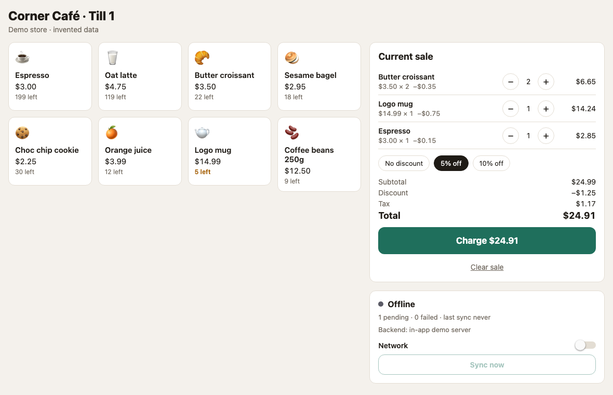
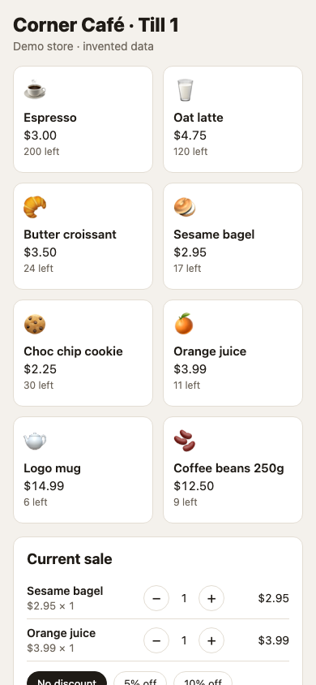
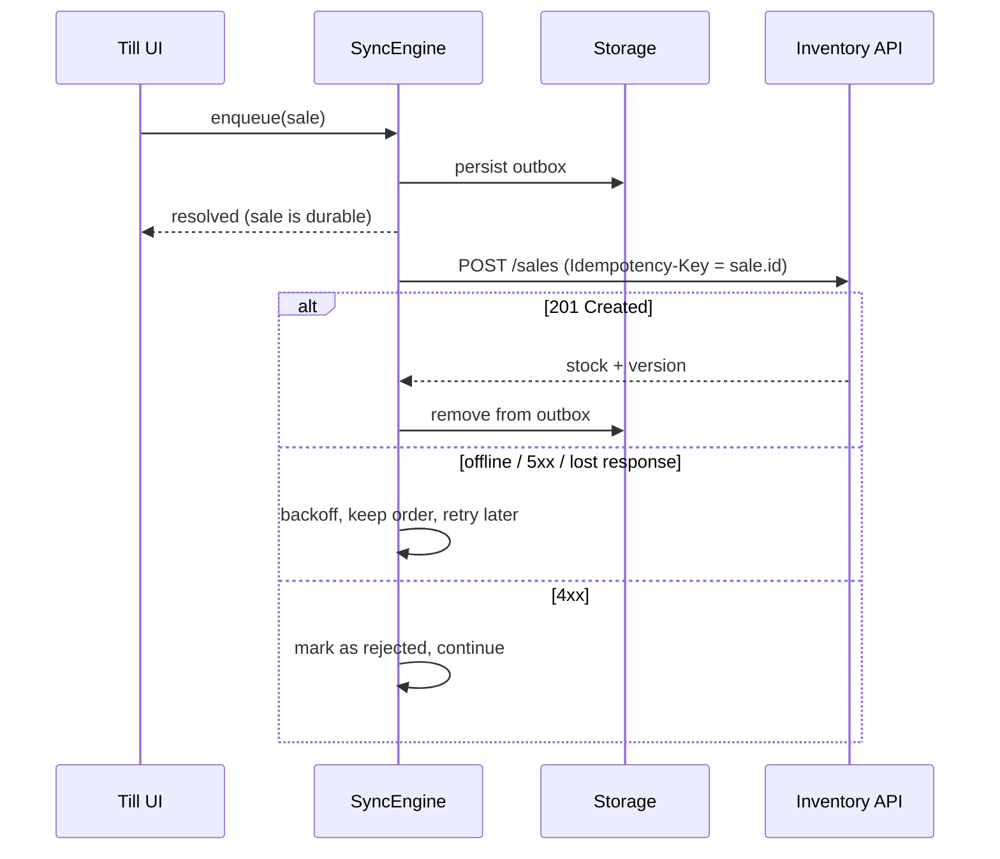

# offline-pos-expo

[](https://github.com/hdamasceno/offline-pos-expo/actions/workflows/ci.yml)


A point-of-sale till in **React Native (Expo)** that keeps selling when the network drops.
Sales go to a durable outbox, and a sync engine delivers each one **exactly once, in order**,
with idempotency keys, exponential backoff with jitter, and server-wins stock reconciliation.

| Tablet / web: a sale queued offline, the next one in progress | Phone |
| --- | --- |
|  |  |

> The café, products and prices are invented demo data.

## Why it is interesting

- **"Charge" never loses a sale.** `enqueue()` resolves only after the sale is in storage, so
  killing the app right after a sale is safe. Writes are serialised so an older snapshot can never
  overwrite a newer one.
- **Exactly once, even when responses get lost.** Each sale's id is sent as an
  `Idempotency-Key`. If the server stores the sale and the response never arrives, the retry
  gets the original response back (`duplicate: true`) instead of selling the goods twice.
- **Ordered delivery.** Sales go oldest first. A transient error (offline, timeout, 5xx, 429)
  stops the run and schedules a retry; nothing newer jumps the queue. A permanent error (4xx) moves
  only that sale to a "rejected" list for a person to retry or discard.
- **Backoff that behaves on a busy morning.** Exponential delay with equal jitter (half fixed,
  half random), capped, and never below the server's `Retry-After`. "Sync now" skips the wait.
- **Stock you can trust.** The till shows *server stock minus the sales the server has not seen
  yet*. Server snapshots carry a version, so a slow, stale response cannot roll stock back.
- **Money in integer cents.** Percentages are basis points, rounding is half-to-even, and the
  whole-order discount is spread across lines with the largest-remainder method, so every receipt
  adds up to the cent.
- **Proven by a chaos test.** A seeded test runs 400 random steps: sales, network flips, 503s,
  lost responses and app restarts. Afterwards, every sale must be on the server exactly once and
  in order, and stock must match.

## Architecture

```
App.tsx                      wires AsyncStorage, expo-crypto ids, and the transport
src/
├── domain/                  pure TypeScript, no React
│   ├── money.ts             Cents/BasisPoints, half-even rounding, exact allocation
│   ├── cart.ts              cart reducer + priceCart() (line discount → order discount → tax)
│   ├── sale.ts              priced cart → immutable sale record
│   └── catalog.ts           invented demo products
├── sync/
│   ├── engine.ts            SyncEngine: outbox, flush loop, persistence, projectStock()
│   ├── backoff.ts           exponential backoff with equal jitter
│   ├── transports.ts        HTTP (fetch + timeout), in-process, and "airplane mode" wrapper
│   └── types.ts             Transport/Storage/Clock interfaces, Transient vs Permanent errors
├── server/
│   └── inventory.ts         the inventory API as a pure request → response function
├── app/                     React context + background sync (timers, AppState)
└── ui/                      PosScreen, ProductGrid, CartPanel, SyncPanel
server/index.ts              the same API over HTTP for real-device testing (plain Node)
```

The engine takes its storage, transport, clock and random source as parameters, so tests drive
it deterministically (fake clock, seeded randomness, in-memory storage) with no mocking library.
The UI subscribes with `useSyncExternalStore`.



## Run it

Requires Node 22.18+.

```bash
npm install
npm run web        # or: npm start, then open in Expo Go / a simulator
```

With no configuration the app talks to an **in-app copy of the API**, so it works anywhere. Flip
the **Network** switch to sell offline, then switch it back and watch the queue drain.

To use the real HTTP server and inject failures:

```bash
FAILURE_RATE=0.3 LOST_RESPONSE_RATE=0.2 npm run server
```

```bash
EXPO_PUBLIC_API_URL=http://<your-computer-ip>:4000 npm start
```

See [`.env.example`](.env.example) for every variable. None of them is secret.

## Test it

| Command | What it runs |
| --- | --- |
| `npm run lint` | ESLint with `eslint-config-expo`, zero warnings allowed |
| `npm run typecheck` | `tsc --noEmit` with `strict` and `noUncheckedIndexedAccess` |
| `npm test` | 61 Jest tests (`jest-expo`): domain, API, sync engine, transports, and screens with React Native Testing Library |
| `npm run coverage` | the same, with coverage (about 94% of lines) |
| `npm run test:e2e` | 3 Playwright tests on the Expo **web** build: the offline sale flow, a queued sale surviving a reload, and the phone layout |
| `npm run screenshots` | regenerates the images in `docs/` |

CI runs lint, typecheck and unit tests, then the Playwright suite, on every push and pull request.

## Not included, on purpose

- No payments: "Charge" records the sale; card processing is out of scope.
- No auth or multi-store tenancy; one till, one in-memory store.
- The in-app demo server forgets its stock on reload, while the outbox does not. That is what lets
  the reload test show persistence on its own.

## License

[MIT](LICENSE) © Henry Lima
